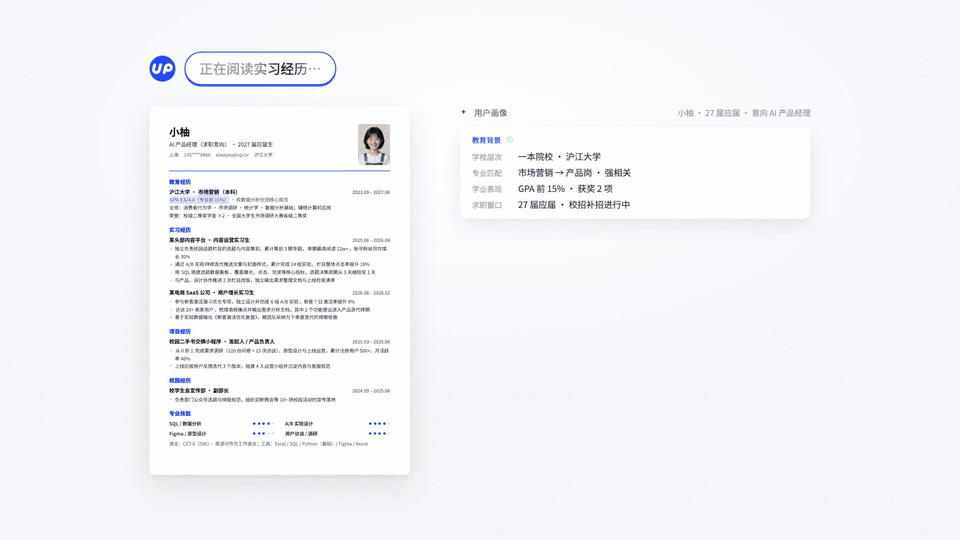

  

  <a href="https://www.upcv.tech/"><b>体验 UP 求职 ↗</b></a> &nbsp; · &nbsp;
  <a href="https://github.com/HireTechUpUp?tab=repositories">开源项目</a> &nbsp; · &nbsp;
  <a href="https://www.upcv.tech/about">关于我们</a>

<h2>让 AI 真正参与求职的每一步</h2>

我们是<strong>向上科技</strong>，专注于 AI 与求职招聘场景。旗下 <strong>UP 求职（原 UP 简历）</strong> 将简历、职位搜索、投递与面试准备连接起来，让求职者把更多精力放在适合自己的机会。

我们也将求职场景中的工具与实践开放给开发者，一起探索 Agent 能为职业发展带来什么。

  

UP 求职官网演示节选 · 示例场景 &nbsp; / &nbsp; <a href="https://www.upcv.tech/">前往官网观看完整演示 ↗</a>

<h3>从一份简历，走向下一次机会</h3>
<ul>
  <li><strong>AI 简历</strong> — 梳理经历，优化表达，对照目标岗位定制简历。</li>
  <li><strong>职位发现</strong> — 获取校招信息，分析岗位匹配度与投递方向。</li>
  <li><strong>投递协作</strong> — 结合浏览器插件，辅助填写网申、准备投递并跟进进度。</li>
  <li><strong>模拟面试</strong> — 围绕目标岗位练习，获得逐题反馈和改进建议。</li>
</ul>

<a href="https://www.upcv.tech/dashboard/agent"><b>打开求职工作台 →</b></a> &nbsp; <a href="https://www.upcv.tech/xiaozhao">浏览校招信息 →</a>

<h2>把求职能力，带进你的 Agent</h2>

从可直接使用的工具，到可复用的提示词和模板，选择适合你的起点。

<table>
<tr>
<td width="50%" valign="top">
<h3><a href="https://github.com/HireTechUpUp/upcv-clawjob">ClawJob ↗</a></h3>

<strong>让你的 Agent 帮你写简历、找工作</strong>

连接熟悉的 Agent 与求职场景，从简历到职位发现。

AGENT · 求职工具

</td>
<td width="50%" valign="top">
<h3><a href="https://github.com/HireTechUpUp/upcv-mcp-server">UPCV MCP Server ↗</a></h3>

<strong>为 Agent 接入简历与校招能力</strong>

通过 MCP 使用简历生成、PDF 输出与校招信息能力。

MCP · 开发者接入

</td>
</tr>
<tr>
<td width="50%" valign="top">
<h3><a href="https://github.com/HireTechUpUp/resume-agent-prompts">Resume Agent Prompts ↗</a></h3>

<strong>求职场景的提示词实践</strong>

覆盖简历优化、职业规划与内容生成，按需取用。

PROMPTS · 场景实践

</td>
<td width="50%" valign="top">
<h3><a href="https://github.com/HireTechUpUp/resume-template">Resume Templates ↗</a></h3>

<strong>从合适的简历模板开始</strong>

面向不同行业与职位的简历模板，帮助清晰呈现经历。

RESOURCES · 简历模板

</td>
</tr>
</table>

<h2>一起，让求职体验向上一步</h2>

欢迎体验产品、反馈问题，也欢迎围绕 Agent、MCP 与求职场景交流合作。

<a href="https://www.upcv.tech/">产品体验</a> &nbsp; / &nbsp; <a href="https://github.com/HireTechUpUp?tab=repositories">项目与贡献</a> &nbsp; / &nbsp; <a href="https://www.upcv.tech/about">了解我们</a> &nbsp; / &nbsp; <a href="https://www.upcv.tech/join">加入我们</a>

UP 求职 · 向上科技 &nbsp; | &nbsp; AI × CAREER &nbsp; | &nbsp; <a href="https://www.upcv.tech/">upcv.tech</a>

